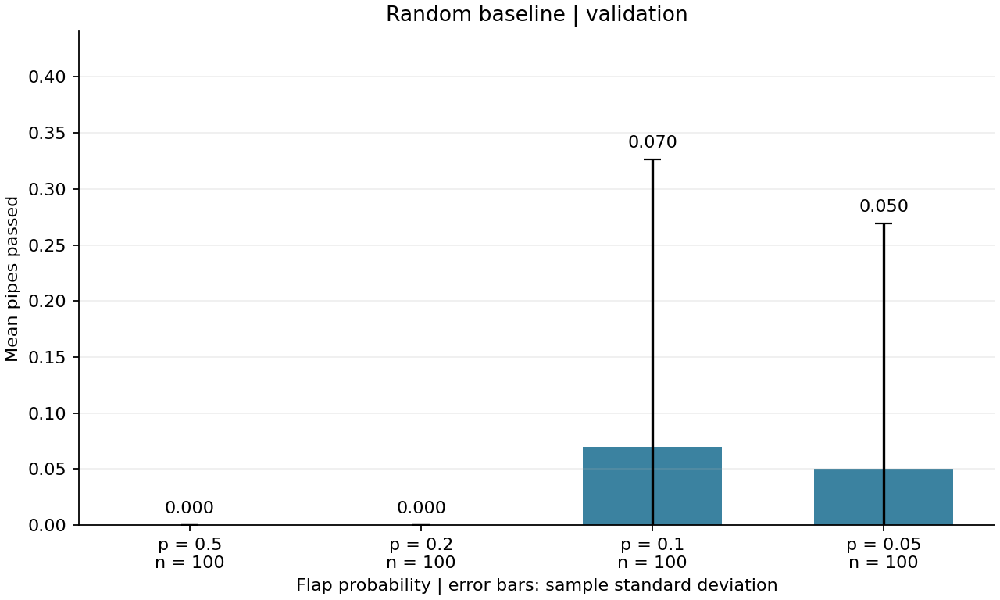
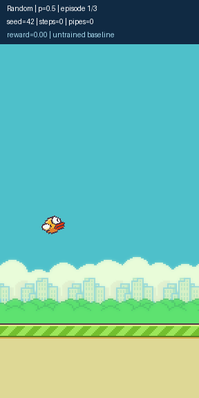

# Flappy Bird RL

Reproducible reinforcement learning experiments in Flappy Bird, developed for **HKU ARIN7101**.

The project provides a shared Gymnasium environment, seeded random baselines, standardized episode metrics, and game recordings. Experiment configurations, evaluation data, and runtime metadata make results easy to reproduce and compare.

## Quick Start

Python 3.10–3.12 is recommended. Run the following commands to set up the project:

```bash
git clone https://github.com/ARIN7101-Group26-2026/flappy-bird-rl.git
cd flappy-bird-rl

python3 -m venv .venv
source .venv/bin/activate
python -m pip install -r requirements.txt

# Verify observations, actions, episode limits, and RGB rendering.
flappy-rl check

# Evaluate four random policies over 100 episodes each.
flappy-rl random --env-config configs/env.json --config configs/random.json

# Record three episodes with the uniform random policy.
flappy-rl demo
```

On Windows PowerShell, create the environment with `py -m venv .venv` and activate it with `.venv\Scripts\Activate.ps1`. All subsequent commands are the same.

The CLI is also available as `python -m flappy_bird_rl`. The baseline and video recording run on CPU; the MP4 encoder is included through `imageio-ffmpeg`. Run subsequent commands from the repository root.

## Environment

The shared environment factory uses [Flappy Bird Gymnasium](https://github.com/markub3327/flappy-bird-gymnasium) with the following configuration:

| Setting | Value |
| --- | --- |
| Environment | `FlappyBird-v0` |
| Observations | 12 normalized numerical features |
| Observation options | `use_lidar=False`, `normalize_obs=True` |
| Actions | `0`: idle; `1`: flap |
| Pipe gap | 100 pixels |
| Episode limit | 5,000 steps via Gymnasium `TimeLimit` |
| Reward | Original environment reward |
| Primary metric | Pipes passed, from `info["score"]` |
| Rendering | Headless, `rgb_array`, or `human`; audio disabled |

The observation contains nine pipe features—horizontal positions and upper/lower boundaries for three pipes—and the bird's vertical position, vertical velocity, and rotation. Feature ordering follows the upstream environment.

All agents can use the same factory and standard Gymnasium interface:

```python
from flappy_bird_rl.env import make_env

env = make_env()
try:
    observation, info = env.reset(seed=42)
    observation, reward, terminated, truncated, info = env.step(0)
finally:
    env.close()
```

Episodes end when either `terminated` or `truncated` is true. Both flags are recorded separately. Episode reward and pipes passed are logged as distinct metrics.

## Random Baseline

The random policy samples a flap independently at each step with probability `p`. The default experiment compares `p ∈ {0.5, 0.2, 0.1, 0.05}`, with 100 episodes per configuration.

Each configuration uses the same environment seed schedule. The action RNG is reset independently for each episode with `action_seed = eval_seed + 1000000`.

| Split | Default environment seeds | Purpose |
| --- | --- | --- |
| Validation | 1000–1099 | Configuration comparison |
| Test | 10000–10099 | Evaluation after configuration selection |
| Demo | 42–44 | Consecutive recorded episodes |

Use validation results to select configurations, then evaluate on the test split. Custom seed ranges should keep the two splits disjoint.

```bash
# Run a smaller experiment: five episodes per probability.
flappy-rl random --episodes 5 --output-dir results/quickcheck

# Evaluate the uniform random policy on the test split.
flappy-rl random --split test --flap-probs 0.5 --output-dir results/random_test

# Set a custom seed range.
flappy-rl random --seed-start 2000 --episodes 20 --output-dir results/custom

# Regenerate figures from the reference results.
flappy-rl plot
```

`--episodes` specifies the number of episodes **per probability**. Reusing an output path overwrites its files; use a separate `--output-dir` for each experiment.

### Reference Results

The included validation run contains 400 episodes using the default configuration:

| Flap probability | Episodes | Mean pipes passed | Sample standard deviation | Mean episode length |
| --- | ---: | ---: | ---: | ---: |
| 0.50 | 100 | 0.000 | 0.000 | 50.00 |
| 0.20 | 100 | 0.000 | 0.000 | 50.17 |
| 0.10 | 100 | 0.070 | 0.256 | 51.12 |
| 0.05 | 100 | 0.050 | 0.219 | 45.97 |



Error bars show the sample standard deviation across episodes. These results describe the specified validation seeds; they do not establish an optimal flap probability.

| Artifact | Description |
| --- | --- |
| [Episode results](results/random_baseline/random_results.csv) | Seeds, scores, rewards, episode lengths, and termination flags |
| [Summary statistics](results/random_baseline/random_summary.csv) | Per-configuration aggregates |
| [Runtime metadata](results/random_baseline/metadata.json) | Environment settings, seed schedule, Python and dependency versions |
| [Score distribution](results/random_baseline/figures/score_distribution.png) | Episode score histograms |

## Video Recording

Record policies as H.264 MP4 files at 30 FPS, or view them in a desktop window:

```bash
# Record all four probabilities, three episodes each.
flappy-rl demo --flap-probs 0.5 0.2 0.1 0.05 --output videos/random/random_comparison.mp4

# Watch a policy in a desktop window.
flappy-rl demo --human --episodes 3 --flap-probs 0.1
```

Recordings stream RGB frames directly to the encoder and include probability, seed, episode length, score, and reward overlays. Each MP4 has a matching episode CSV, metadata JSON, and PNG preview.

- [Uniform random policy](videos/random/random_demo.mp4): three consecutive episodes, 5.1 seconds.
- [Probability comparison](videos/random/random_comparison.mp4): twelve consecutive episodes, approximately 19 seconds.

Recordings and their metadata are versioned in the repository under `videos/<algorithm>/`. Browse the [video directory](videos/README.md) for playback links and reproduction commands.

[](videos/random/random_comparison.mp4)

## Standalone High-Score Track: PQN

A self-contained result lives in [`sota/`](sota/README.md), next to the framework rather than inside its algorithm packages. It trains a PQN agent (ICLR 2025) with the shared environment factory and scores it with the shared episode runner, so its episode CSVs follow the same contract as every other agent.

| Agent | Split | Episodes | Mean pipes passed (ceiling 132) | Episodes reaching the time limit |
| --- | --- | ---: | ---: | ---: |
| Random, flap probability 0.1 | validation | 100 | 0.07 | 0 |
| PQN, 20 training seeds | test | 2,000 | 131.94 | 1,998 |

The track also contains an exhaustive verifier. It enumerates every game state a trained policy can reach and returns the exact probability that the agent dies in a 5,000-step episode: 5.9 × 10⁻⁴ for the median of the 20 agents and 4.1 × 10⁻¹⁰ for the best one.

- [Report](sota/README.md): method, results, ablations, limitations.
- [Research notes](sota/RESEARCH.md): public results on this game and the algorithms considered.
- [Recording](videos/pqn/pqn_demo.mp4): one full 5,000-step episode.
- [Results comparison (PDF)](docs/pqn_effect_comparison.pdf): baseline, protocol results, exact risk, ablations.

```bash
# Play the committed agent on the test split, then re-run its exhaustive check.
python -m sota.evaluate protocol --checkpoints sota/models/pqn_champion.npz --splits test --output-dir results/pqn_check
python -m sota.verify --checkpoints sota/models/pqn_champion.npz --exact-horizon 5000
```

## Project Structure

```text
flappy-bird-rl/
├── configs/
│   ├── env.json             # Shared environment configuration
│   ├── random.json          # Random baseline configuration
│   ├── dqn.json             # DQN configuration
│   └── ppo.json             # PPO configuration
├── src/flappy_bird_rl/
│   ├── agents/
│   │   ├── base.py          # Shared Policy interface
│   │   ├── random/
│   │   │   └── agent.py     # Seeded Bernoulli policy
│   │   ├── dqn/
│   │   │   ├── agent.py     # DQN policy implementation
│   │   │   └── train.py     # DQN training implementation
│   │   └── ppo/
│   │       ├── agent.py     # PPO policy implementation
│   │       └── train.py     # PPO training implementation
│   ├── env.py               # Shared Gymnasium environment factory
│   ├── config.py            # Configuration loading and validation
│   ├── evaluate.py          # Episode evaluation and metrics
│   ├── plot.py              # Score summaries and distribution plots
│   ├── demo.py              # Video recording and metadata
│   └── cli.py               # Command-line entry points
├── sota/                    # Standalone PQN track: code, models, results, report
├── tests/                   # Environment, evaluation, CLI, and video tests
├── docs/                    # Architecture and experiment documentation
├── models/
│   ├── dqn/                 # DQN checkpoints
│   └── ppo/                 # PPO checkpoints
├── logs/                    # Experiment logs
├── results/random_baseline/ # Reference evaluation data and figures
├── videos/
│   ├── README.md            # Video index and playback links
│   ├── random/              # Random MP4s, previews, and episode metadata
│   ├── dqn/                 # DQN recordings
│   └── ppo/                 # PPO recordings
├── .github/workflows/ci.yml
├── pyproject.toml
├── requirements.txt
└── requirements-lock.txt
```

Each algorithm has a dedicated implementation package:

| Algorithm | Policy module | Training module | Configuration |
| --- | --- | --- | --- |
| Random | [agents/random/agent.py](src/flappy_bird_rl/agents/random/agent.py) | — | [random.json](configs/random.json) |
| DQN | [agents/dqn/agent.py](src/flappy_bird_rl/agents/dqn/agent.py) | [agents/dqn/train.py](src/flappy_bird_rl/agents/dqn/train.py) | [dqn.json](configs/dqn.json) |
| PPO | [agents/ppo/agent.py](src/flappy_bird_rl/agents/ppo/agent.py) | [agents/ppo/train.py](src/flappy_bird_rl/agents/ppo/train.py) | [ppo.json](configs/ppo.json) |

Policies implement [the shared interface](src/flappy_bird_rl/agents/base.py) through `reset(seed)` and `predict(observation)`. Environment creation, episode evaluation, metrics, and video capture are shared across algorithm packages. Evaluation exports a consistent schema for agent identity, configuration, training and evaluation seeds, training steps, episode metrics, and termination flags.

## Development

Install the development dependencies and run the checks:

```bash
python -m pip install -e '.[dev]'
python -m pytest -q
python -m ruff check .
python -m ruff format --check .
```

The GitHub Actions workflow runs these checks on Python 3.10 and 3.12, together with environment, evaluation, and video smoke checks.

For experiments using Stable-Baselines3, PyTorch, and TensorBoard:

```bash
python -m pip install -e '.[train]'
```

To train the standalone PQN agent in `sota/` (playing and verifying it needs no extra):

```bash
python -m pip install -e '.[sota]'
```

To reproduce the recorded dependency snapshot, verified on CPython 3.10 / Linux x86_64:

```bash
python -m pip install -r requirements-lock.txt
python -m pip install --no-deps -e .
```

## License

Project code is released under the [MIT License](LICENSE). The game environment and assets are supplied by [Flappy Bird Gymnasium](https://github.com/markub3327/flappy-bird-gymnasium) under their respective licenses.
