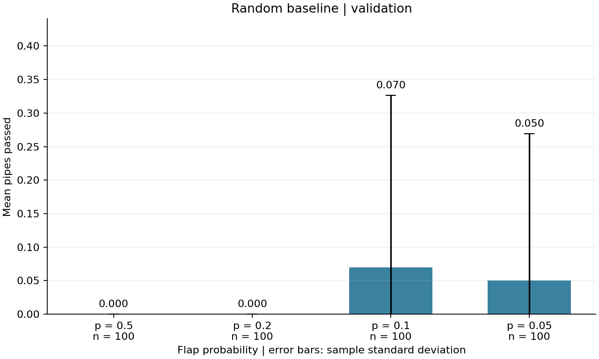

# Flappy Bird RL

面向小组实验的 Flappy Bird 强化学习仓库。当前完成 **公共环境 + Random Baseline**：可复现实验、CSV 汇总、两张统计图、真实游戏视频，以及供 DQN / PPO 复用的评估接口。

基于[项目讨论](https://chatgpt.com/share/6adc20ae-d04c-83ec-beb1-a891bec7ea00)的统一约定实现。DQN、PPO 配置是后续开发模板，尚未实现训练或产出模型；Reward Shaping 尚未启用。

## 1. 安装与首次运行

建议 Python 3.10–3.12。基础流程只使用 CPU，无需安装 PyTorch。以下命令在仓库根目录运行：

```bash
python3 -m venv .venv
source .venv/bin/activate
python -m pip install --upgrade pip
python -m pip install -r requirements.txt

# 校验 12 维状态、两个动作、TimeLimit 和 RGB 渲染
python -m flappy_bird_rl check

# 4 种概率 × 100 局，输出数据和两张图
python -m flappy_bird_rl random --env-config configs/env.json --config configs/random.json

# 录制连续 3 局、p=0.5 的 Random 示范
python -m flappy_bird_rl demo
```

Windows PowerShell 创建环境使用 `py -m venv .venv`，激活使用 `.venv\Scripts\Activate.ps1`，之后的 `python` 命令相同。激活后也可用 `flappy-rl` 代替 `python -m flappy_bird_rl`。

如当前机器配置的镜像不可用，在安装命令后加 `--index-url https://pypi.org/simple`。完整的已验证依赖快照位于 `requirements-lock.txt`；需要复现该快照时使用：

```bash
python -m pip install -r requirements-lock.txt
python -m pip install --no-deps -e .
```

## 2. 已附带的实际结果

- [400 局逐局结果](results/random_baseline/random_results.csv)
- [按概率汇总](results/random_baseline/random_summary.csv)
- [运行参数、种子和依赖版本](results/random_baseline/metadata.json)
- [均值及标准差图](results/random_baseline/figures/mean_pipes.png)
- [得分分布图](results/random_baseline/figures/score_distribution.png)
- [Random 示范视频](videos/random_demo.mp4)及[逐局记录](videos/random_demo.csv)
- [四种概率连续示范](videos/random_comparison.mp4)（每组 3 局，共 12 局）
- [本次验收与结果解读](docs/baseline_report.md)



这些是随机策略的测量结果，不代表已经训练过的智能体。即使多数局得分为 0，也如实保留，不用挑选成功片段替代统计结果。

## 3. 统一环境

| 项目 | 当前设置 |
| --- | --- |
| 环境 | `FlappyBird-v0`，`flappy-bird-gymnasium==0.4.0` |
| 状态 | 12 维数值特征；`use_lidar=False`、`normalize_obs=True` |
| 动作 | `0` 不拍翅膀，`1` 拍翅膀 |
| 奖励 | 保留上游原始奖励 |
| 得分 | 只读 `info["score"]`，不从 reward 反推 |
| 上限 | `TimeLimit(max_episode_steps=5000)` |
| 结束 | `terminated or truncated`，两个标志分别记录 |
| 显示 | 无渲染 / `rgb_array` / `human`；关闭音效 |

12 个特征依次描述三个管道的横坐标、上下边缘（共 9 维），以及小鸟的纵坐标、纵向速度和旋转角（3 维）；顺序与上游实现一致。动作策略不能把某个固定索引永远视为“当前最近的障碍”，应理解上游管道排序与占位逻辑。

原始奖励通常为存活一步 `+0.1`、通过管道 `+1`、死亡 `-1`、触顶 `-0.5`。同一步不是简单叠加所有奖励，具体覆盖规则由上游环境决定。

```python
from flappy_bird_rl.env import make_env

env = make_env()
try:
    obs, info = env.reset(seed=42)
    obs, reward, terminated, truncated, info = env.step(0)
finally:
    env.close()
```

## 4. Random 实验与视频

Random 每步独立采样 `Bernoulli(p)`，不使用观测，也不训练。默认比较 `p ∈ {0.5, 0.2, 0.1, 0.05}`，每组 100 局，所有组复用同一组环境种子。

| 用途 | 默认环境种子 | 说明 |
| --- | --- | --- |
| 验证集 | 1000–1099 | 比较概率、探索配置 |
| 测试集 | 10000–10099 | 配置确定后的独立评估 |
| 视频 | 42–44 | 连续三局，未挑选结果 |

动作 RNG 使用 `eval_seed + 1000000`，每局重新初始化。各概率共享种子以便配对比较，动作 RNG 不消耗环境 RNG。CSV 的 `train_seed` 为空、`train_steps=0`。视频 JSON 记录帧率、帧数和运行配置。

```bash
# 快速检查：每种概率 5 局，使用新的输出目录
flappy-rl random --episodes 5 --output-dir results/quickcheck

# 正式测试：这里演示预先指定的标准 Random p=0.5
# 切换 split 会默认使用测试种子 10000 起；也可显式指定 seed-start
flappy-rl random --split test --flap-probs 0.5 --output-dir results/random_test

# 手动指定种子时，应自行保证验证集与测试集不重叠
flappy-rl random --seed-start 2000 --episodes 20 --output-dir results/custom

# 把四种概率各三局依次录到一个视频中
flappy-rl demo --flap-probs 0.5 0.2 0.1 0.05 --output videos/random_comparison.mp4

# 有桌面时弹出游戏窗口；Ctrl+C 可结束
flappy-rl demo --human --episodes 3 --flap-probs 0.1

# 只从 CSV 重画图
flappy-rl plot
```

无桌面服务器直接使用默认 MP4 模式：`rgb_array` 不创建显示窗口，编码器由 `imageio-ffmpeg` 提供。视频为 30 FPS、H.264；顶部文字显示概率、种子、步数、实际过管数和累计奖励。每局包含 reset 帧以及所有交互帧。

每次运行会覆盖同名输出；需要保留对比实验时请指定不同的 `--output-dir` 或 `--output`。`--episodes` 表示**每个概率的局数**。

## 5. 仓库结构与分工

```text
flappy-bird-rl/
├── configs/                 # 环境、Random；DQN/PPO 预设模板
├── src/flappy_bird_rl/
│   ├── env.py               # A：唯一公共环境入口
│   ├── config.py            # 配置与校验
│   ├── random_agent.py      # A：可复现随机策略
│   ├── evaluate.py          # 公共 Policy 协议、单局运行、CSV/统计
│   ├── plot.py              # 得分均值、分布图
│   ├── demo.py              # 流式 MP4 录制及运行元数据
│   └── cli.py               # check / random / demo / plot
├── tests/                   # 环境集成、复现性、终止、CLI/视频测试
├── docs/                    # 架构、开发任务、实际验收报告
├── models/{dqn,ppo}/        # B/C：后续模型目录，当前无模型
├── logs/                    # 后续训练日志
├── results/random_baseline/ # 本次真实的 400 局验证结果
├── videos/                  # Random 示范及逐局元数据
├── .github/workflows/ci.yml
├── pyproject.toml           # 可安装的 src-layout 包、依赖、命令入口
├── requirements.txt
└── requirements-lock.txt    # 本次验证的精确依赖快照
```

后续 B/C 的训练代码放入包中，使用同一个 `make_env()`。D 的奖励包装器仅用于训练；最终统一评估必须重新创建原始奖励环境。协议、字段说明和具体接入示例见 [architecture.md](docs/architecture.md)，任务边界见 [roadmap.md](docs/roadmap.md)。

## 6. 开发与验证

```bash
python -m pip install -e '.[dev]'
python -m pytest -q
python -m ruff check .
python -m ruff format --check .
```

CI 配置会在 Python 3.10 / 3.12 下运行上述检查，另外跑环境检查和短版 Random / MP4 冒烟测试。本次交付的实际验证平台见验收报告；仓库尚未推送到远程，因此不宣称远程 CI 已运行。

后续开始训练时可选安装 `python -m pip install -e '.[train]'`。这会安装 Stable-Baselines3 / PyTorch / TensorBoard，不是 Random 示例的前置依赖。

## 7. 参考与许可

- [原始项目讨论](https://chatgpt.com/share/6adc20ae-d04c-83ec-beb1-a891bec7ea00)
- [上游 Flappy Bird 环境及素材来源](https://github.com/markub3327/flappy-bird-gymnasium)
- [Gymnasium TimeLimit 与终止语义](https://gymnasium.farama.org/api/wrappers/misc_wrappers/)

本仓库新增代码采用 MIT 许可；游戏环境及素材由上游依赖提供，保留其各自许可。
