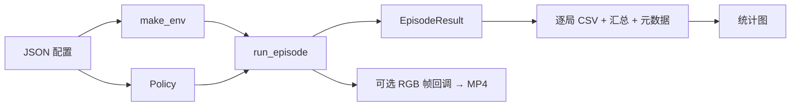

# 公共接口与实验约定

## 数据流



环境、策略、评估、展示分别放在独立模块。`make_env()` 是统一入口，使用 Gymnasium 自带的 `max_episode_steps` 参数安装一个 TimeLimit。环境配置显式序列化到输出目录，方便在比较前确认任务条件相同。

## 策略与评估接口

算法实现按 `src/flappy_bird_rl/agents/{random,dqn,ppo}/` 分包，策略适配放在各自的 `agent.py` 中，DQN/PPO 训练入口放在各自的 `train.py` 中。公共协议定义在 `agents/base.py`，视频按 `videos/{random,dqn,ppo}/` 归档。

策略满足 `Policy` 协议：

```python
class Policy:
    def reset(self, seed: int) -> None: ...
    def predict(self, observation) -> int: ...
```

`run_episode()` 在每局开始时调用 `reset()`，随后循环 `predict()`，直到 `terminated or truncated`。它不关闭环境，调用者应在 `finally` 中关闭，以支持连续评估。创建策略时不得修改全局 RNG。

后续的 Stable-Baselines3 模型可以用以下适配器接入（示例，不是本阶段已训练的模型）：

```python
class SB3Policy:
    def __init__(self, model):
        self.model = model

    def reset(self, seed):
        pass  # 当前计划使用无隐藏状态的确定性 MLP

    def predict(self, observation):
        action, _ = self.model.predict(observation, deterministic=True)
        return int(action)
```

加载模型后，在独立 `make_env()` 上调用 `run_episode()`，传入 `agent="DQN"` 或 `"PPO"`、真实 `train_seed`、模型实际 `train_steps`。如果改成递归网络或随机评估，必须相应实现隐藏状态重置及策略随机种子。

## CSV 合约

| 字段 | 含义 |
| --- | --- |
| agent | `Random` / 后续 `DQN` / `PPO` |
| config | 可区分的实验名称，如 `random_p0.1` |
| train_seed | 训练种子；Random 为空 |
| eval_seed | 本局环境 `reset(seed=...)` 的种子 |
| action_seed | 策略的独立种子 |
| train_steps | 模型实际累计环境采样步数；Random 为 0 |
| episode_steps | 本局执行 `step()` 次数 |
| pipes_passed | 末帧 `info["score"]`，实际管道数 |
| episode_reward | 原始环境返回奖励的和 |
| terminated / truncated | 两个独立布尔标志，可能同时为真 |
| flap_prob | Random 的概率；其他策略为空 |
| split | validation / test / demo |

汇总按 `(agent, config, train_seed, split)` 分组，报告管道数的均值、样本标准差、中位数、最大值，步数与奖励的均值及标准差，结束标志计数。标准差使用 `ddof=1`；只有一局时约定显示 0。两个结束标志可同时为真，所以两项计数不保证互斥。

## 公平比较

1. 验证集默认 1000–1099；测试集默认 10000–10099。选概率或超参数只能看验证集，确定后再做测试。
2. 相同 split 的不同策略复用同一组环境种子；动作 RNG 与环境 RNG 分开。
3. 四种 Random 概率使用相同动作种子，形成配对随机流；不能把四组当成完全独立的样本。
4. 后续 DQN/PPO 使用多个独立训练种子。每模型测试 100 局只反映该模型的回合波动，不能代替多次训练衡量训练稳定性。
5. 原始奖励和塑形奖励不可混作同一列。最终评估使用未塑形环境，并以管道分数为主指标。
6. PPO 可能超出请求的训练步数，记录实际 `model.num_timesteps`，同时报告训练时间。
7. 当前脚本允许自定义 seed_start / episodes；自定义时由实验者保证验证与测试种子不重叠，元数据保留实际区间。

## 当前边界

第一阶段固定使用 12 维归一化特征。改变 LIDAR、观测标准化或游戏物理应作为命名清晰的新实验，不应静默混入当前基线。录制器以 `rgb_array` 流式写入 FFmpeg，不将整局帧缓存在内存中；不会改变策略动作序列。
