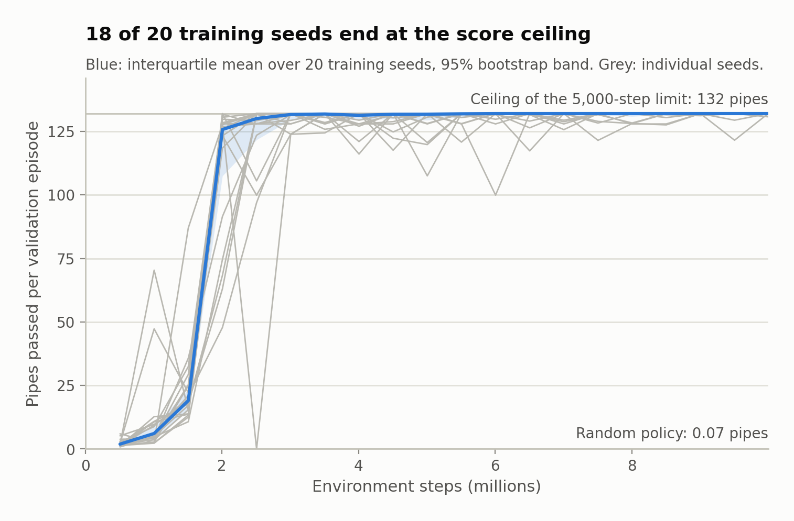
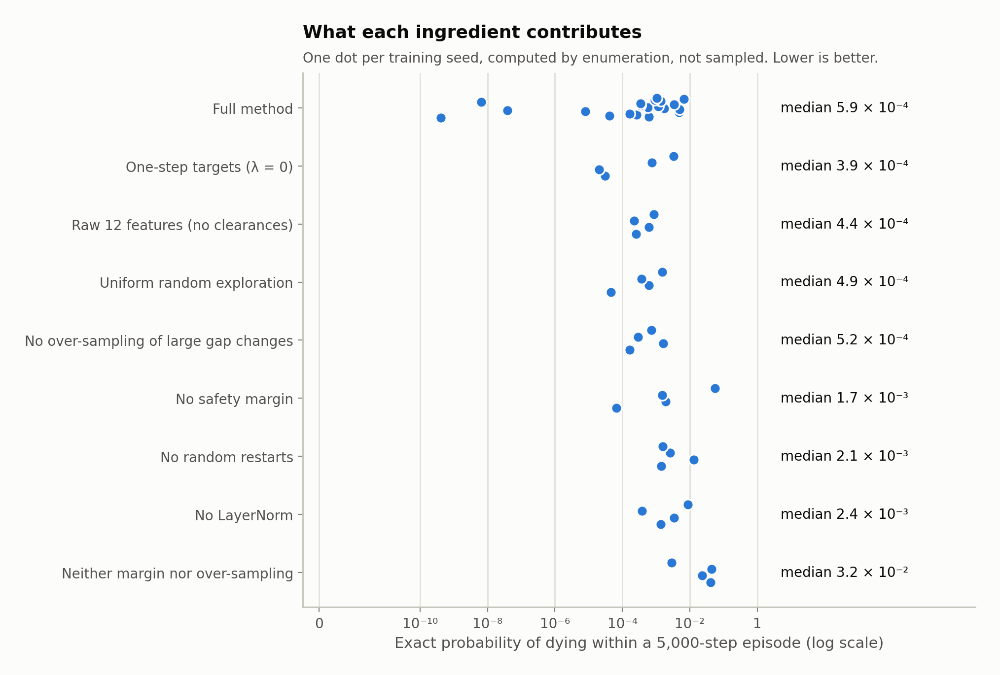
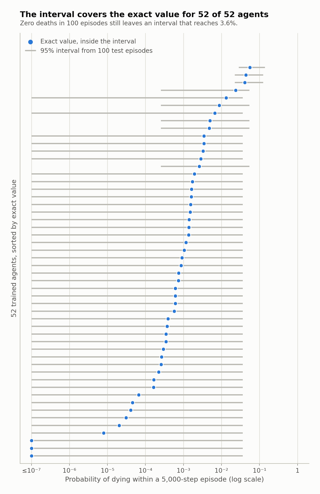
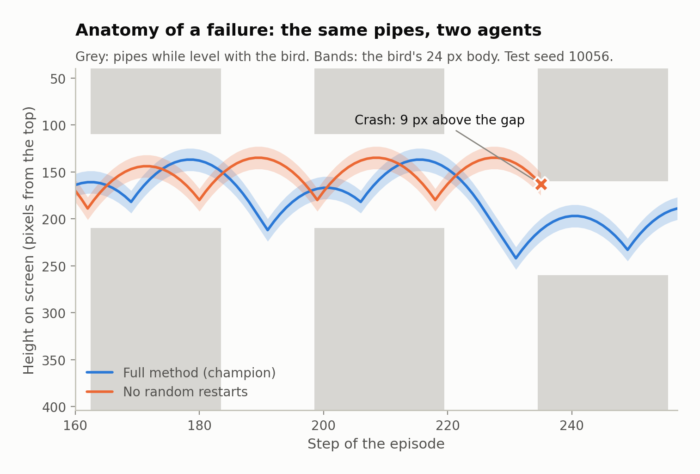
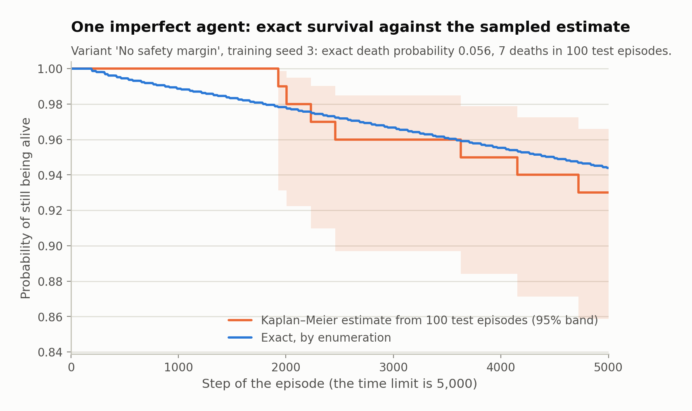

# Flappy Bird at the score ceiling, with its risk computed exactly

A standalone result that sits next to the framework rather than inside it. It trains
with the shared environment factory and is scored by the shared episode runner, so its
numbers line up with every other agent in this repository.

**What was built**

- **A PQN agent** ([Gallici et al., ICLR 2025](https://arxiv.org/abs/2407.04811)),
  implemented from scratch in PyTorch, plus three training-only changes, each added
  after a failure seen in early runs.
- **An exhaustive verifier.** It enumerates every game state a trained policy can reach
  and returns the *exact* probability that the agent dies, where ordinary evaluation can
  only estimate it from samples.

**Headline numbers**

| | Random policy (best of four) | PQN, this work |
| --- | ---: | ---: |
| Pipes per episode, standard protocol (ceiling 132) | 0.07 | 131.94 |
| Episodes that reach the 5,000-step limit | 0 of 100 | 1,998 of 2,000 |
| Probability of dying in a standard episode | 1 | 5.9 × 10⁻⁴ (median agent), 4.1 × 10⁻¹⁰ (best agent) |

- The Random column is the repository's baseline (validation split, flap probability 0.1).
- The PQN column is the test split over 20 independently trained agents, 100 episodes
  each. 18 of the 20 agents score 132 on all 100 test episodes.
- The last row is exact, not estimated. For the best agent it means one death in about
  2.5 billion episodes. Left to play without a time limit, it crashes about once per
  1.5 × 10¹¹ pipes, roughly 6,000 years of continuous play at 30 frames per second.

## Contents

| Path | What it is |
| --- | --- |
| [RESEARCH.md](RESEARCH.md) | Survey: public results on this game, recent algorithms, why PQN |
| [pqn.py](pqn.py), [targets.py](targets.py), [vec_env.py](vec_env.py) | Training |
| [policy.py](policy.py) | NumPy-only inference; playing the agent needs no PyTorch |
| [verify.py](verify.py), [game_state.py](game_state.py) | Exhaustive verifier and exact survival |
| [evaluate.py](evaluate.py), [stats.py](stats.py), [analyze.py](analyze.py) | Evaluation, statistics, figures |
| [models/](models/) | The best agent and all 20 main agents (`.npz`, about 290 kB each) |
| [results/](results/) | Every number and figure below, as CSV, JSON and PNG |
| [../videos/pqn/](../videos/pqn/) | A full 5,000-step episode |
| [../docs/pqn_effect_comparison.pdf](../docs/pqn_effect_comparison.pdf) | Results comparison as a PDF |
| [reproduce.sh](reproduce.sh) | The whole pipeline, start to finish |

## 1. Why this approach

The survey in [RESEARCH.md](RESEARCH.md) found three things.

1. **Nobody has shown a learned agent on this environment that keeps flying.** The best
   public result on the 12-feature observation is PPO reaching a 200-pipe cap in 8 of 10
   episodes; replay-buffer DQN averages 20 to 72 pipes.
2. **The simulator is cheap** (140,000 steps per second on one CPU core). That favours
   an algorithm built for abundant data over one built for sample efficiency.
3. **PQN is the newest algorithm that fits.** It drops the replay buffer and the target
   network, and gets stability from LayerNorm and data from parallel environments.

## 2. Method

### 2.1 PQN, as implemented here

- 256 copies of the shared environment are stepped in one process.
- Every 32 steps the collected transitions are fitted for 4 epochs of 16 minibatches,
  with squared error to λ-returns (λ = 0.65, γ = 0.99).
- The Q-network is a two-layer MLP of width 256 with LayerNorm before each ReLU. There
  is no replay buffer and no target network.
- The optimiser is RAdam, with gradient-norm clipping at 10 and a learning rate that
  decays linearly from 2.5e-4 to zero.
- Exploration is ε-greedy, with ε decaying from 1 to 0.005 over the first 20% of training.
- One run is 10 million environment steps and takes about 10 minutes on one CPU core.

Two details differ from the reference implementations, both on purpose:

| Detail | Reference PQN | Here | Why |
| --- | --- | --- | --- |
| Episode cut off by a time limit | Treated as a death | Bootstraps across the cut | A cutoff is not a death ([Pardo et al., 2018](https://arxiv.org/abs/1712.00378)) |
| Random exploratory action | Uniform over actions | Flap with probability 0.1 | Flapping half the time pins the bird to the ceiling; the repository's Random study scored highest at 0.1 |

The network also receives six extra inputs: the bird's clearance to the upper and lower
edge of each of the three pipes. Each is a difference of two existing inputs, so no
information is added; the network just no longer has to learn subtraction to pixel
accuracy.

### 2.2 Three training-only changes

None of them changes what the agent observes or how it is evaluated. Each was added
after a failure seen in early runs; section 4.3 measures what each is worth.

| # | Failure seen in early runs | Change in training |
| --- | --- | --- |
| 1 | **The agent forgets how to start.** As it improves, episodes last 5,000 steps, and the first 60 steps of an episode shrink to about 1% of the data. Agents that then flew for tens of thousands of pipes still crashed in the first seconds of about 1 episode in 100. | **Random restarts.** Each training episode is cut with probability 1/400 per step, so starts stay common. The cut is a truncation, so targets bootstrap across it. |
| 2 | **Rare pipe pairs are the deadly ones.** In one agent, two thirds of the risk came from a single opening: the highest gap followed by the lowest, which starts 1 episode in 64. | **Over-sample large gap changes.** With probability 0.5, a new training pipe takes the extreme gap farthest from the previous one. |
| 3 | **Misses by a few pixels.** The plan was right but ran along the edge of what is survivable, so a small error in the value function was fatal. | **Safety margin.** In training, coming within 6 px vertically or 4 px horizontally of a pipe counts as a crash. The agent learns to keep that clearance; in evaluation it is spare room. |

### 2.3 What is deliberately not changed

- The environment is `make_env()` with `configs/env.json`: 12 features, original reward,
  100 px gap, 5,000-step limit.
- The evaluated policy is deterministic: the action with the larger Q-value.
- The reward values are the environment's own. The one training-time change to when
  they are given is the safety margin of section 2.2, which never applies in evaluation.
- There is no checkpoint selection. The agent of a run is its last checkpoint.

## 3. Evaluation: three levels of evidence

| Level | What it does | What it can show |
| --- | --- | --- |
| **Standard protocol** | 100 validation and 100 test episodes through the shared `run_episode` | Comparable with every other agent in the repository |
| **Larger samples** | 10,000 fresh episodes; episodes of one million steps | Exact binomial bounds on the death rate |
| **Exhaustive verification** | Enumerates all reachable states of the policy | The death probability itself, with no sampling error |

**Why the third level is possible.** The game is deterministic except for the height of
each new gap, which takes one of eight values. A deterministic policy therefore turns
the game into a finite Markov chain. The verifier starts from all eight openings,
follows the policy, and branches eight ways whenever a pipe comes into view. It uses
the real environment's own `step` as the transition function, so nothing is
re-implemented. Pushing the start distribution through this chain gives the exact
probability of being alive after every step.

**Checks on the verifier itself** (all in `tests/test_sota.py`):

- A policy that never flaps is found to die at step 31 in all eight openings.
- A policy that always flaps dies at step 50, the figure the repository's Random study
  measured for flap probability 0.5.
- For a hand-written rule that dies at varied times, the exact survival curve agrees
  with 400 ordinary seeded episodes at every checked step.

## 4. Results

### 4.1 Standard protocol

20 agents, one per training seed, each played on the framework's validation and test
seeds through the shared `run_episode`.

| Split | Agents × episodes | Mean pipes per episode | Episodes at the ceiling of 132 | Deaths |
| --- | ---: | ---: | ---: | ---: |
| Validation (seeds 1000–1099) | 20 × 100 | 131.97 | 1,998 of 2,000 | 2 |
| Test (seeds 10000–10099) | 20 × 100 | 131.94 | 1,998 of 2,000 | 2 |

- 18 of 20 agents are at 132 on every test episode. The interquartile mean over agents
  is 132.00, with a bootstrap interval that does not leave 132.00.
- The two test deaths belong to training seeds 14 and 17, the two validation deaths to
  seeds 3 and 10. Three of these four agents are among the five riskiest by the exact
  analysis below.
- Every agent first reached a clean validation pass between 2.0 and 4.0 million steps
  (median 2.8 million).



Files: [protocol/pqn_results.csv](results/protocol/pqn_results.csv) (one row per
episode, shared CSV contract), [curves/main.csv](results/curves/main.csv).

### 4.2 Exact death probability

At the ceiling the standard protocol stops telling agents apart. The verifier does not.

| Training seed | Exact probability of dying in a 5,000-step episode | Deaths in 100 test episodes | Reachable states | Fatal transitions |
| ---: | ---: | ---: | ---: | ---: |
| 0 (best) | 4.1 × 10⁻¹⁰ | 0 | 3,373,969 | 1,128 |
| 5 | 6.5 × 10⁻⁹ | 0 | 3,442,456 | 2,031 |
| 16 | 3.9 × 10⁻⁸ | 0 | 3,640,224 | 1,116 |
| 15 | 7.9 × 10⁻⁶ | 0 | 3,688,667 | 897 |
| 11 | 4.1 × 10⁻⁵ | 0 | 3,428,854 | 1,368 |
| 13 | 1.7 × 10⁻⁴ | 0 | 3,355,853 | 423 |
| 12 | 2.7 × 10⁻⁴ | 0 | 3,476,417 | 1,192 |
| 4 | 3.5 × 10⁻⁴ | 0 | 3,637,904 | 1,293 |
| 2 | 3.5 × 10⁻⁴ | 0 | 3,566,752 | 1,695 |
| 19 | 5.7 × 10⁻⁴ | 0 | 3,497,366 | 1,779 |
| 10 | 6.1 × 10⁻⁴ | 0 | 3,811,830 | 2,307 |
| 7 | 9.1 × 10⁻⁴ | 0 | 3,587,439 | 1,339 |
| 9 | 1.0 × 10⁻³ | 0 | 3,438,282 | 1,086 |
| 1 | 1.2 × 10⁻³ | 0 | 3,471,629 | 1,253 |
| 6 | 1.4 × 10⁻³ | 0 | 3,490,622 | 1,712 |
| 18 | 1.7 × 10⁻³ | 0 | 3,735,284 | 1,749 |
| 3 | 3.5 × 10⁻³ | 0 | 3,648,135 | 1,506 |
| 14 | 4.8 × 10⁻³ | 1 | 3,586,712 | 1,396 |
| 17 | 5.0 × 10⁻³ | 1 | 3,805,742 | 1,701 |
| 8 | 6.7 × 10⁻³ | 0 | 3,678,648 | 1,677 |

- **The recipe.** The median agent dies in 5.9 × 10⁻⁴ of episodes, about 1 in 1,700.
  All 20 are below 1 in 100, 12 are below 1 in 1,000, and 3 are below 1 in a million.
- **The spread.** The same recipe gives agents seven orders of magnitude apart,
  depending only on the training seed. One good agent says little about a method.
- **A consistency check.** Summing the exact probabilities predicts 2.85 deaths in the
  2,000 test episodes. We observed 2.

**The best agent (training seed 0)**, verified over a longer horizon of 20,000 steps:

| Quantity | Value |
| --- | ---: |
| Probability of dying in a 5,000-step episode | 4.1 × 10⁻¹⁰ |
| Earliest step at which any pipe sequence can kill it | 1,252 |
| Death probability per pipe, long run | 6.7 × 10⁻¹² |
| Expected pipes before a crash | about 1.5 × 10¹¹ |
| The same at 30 frames per second | about 6,000 years |
| Smallest gap between the two Q-values at any reachable state | 9.3 × 10⁻⁷ |

It was chosen by the exact analysis alone, so no sampled validation or test episode
took part in the choice. Its 1,128 fatal transitions are all collisions with an upper
pipe, and none of them can be reached in the first 1,251 steps of an episode.

Files: [verification/main.json](results/verification/main.json),
[verification/champion.json](results/verification/champion.json).

### 4.3 What each ingredient is worth

Each row removes one thing from the full method and retrains four seeds. The measure is
the exact death probability, compared with the 20 full-method seeds by an exact
Mann–Whitney test.



| Variant | Seeds | Median exact death probability | Relative to full | Chance that a full-method seed is safer | Exact p-value |
| --- | ---: | ---: | ---: | ---: | ---: |
| **Full method** | 20 | 5.9 × 10⁻⁴ | 1× | | |
| Neither safety margin nor over-sampling | 4 | 3.2 × 10⁻² | 55× | 0.95 | 0.002 |
| No LayerNorm | 4 | 2.4 × 10⁻³ | 4.1× | 0.75 | 0.135 |
| No random restarts | 4 | 2.1 × 10⁻³ | 3.6× | 0.82 | 0.045 |
| No safety margin | 4 | 1.7 × 10⁻³ | 3.0× | 0.70 | 0.241 |
| No over-sampling of large gap changes | 4 | 5.2 × 10⁻⁴ | 0.9× | 0.47 | 0.911 |
| Uniform random exploration | 4 | 4.9 × 10⁻⁴ | 0.8× | 0.50 | 1.000 |
| Raw 12 features, no clearances | 4 | 4.4 × 10⁻⁴ | 0.7× | 0.42 | 0.682 |
| One-step targets (λ = 0) | 4 | 3.9 × 10⁻⁴ | 0.7× | 0.44 | 0.737 |

What the data support, and what they do not:

- **The safety margin and the over-sampling are substitutes.** Removing either one
  changes nothing we can detect. Removing both makes the agent 55 times more likely to
  die, the one difference that survives a correction for eight comparisons
  (p = 0.002 against a threshold of 0.006). The full method keeps both only because it
  was fixed before this table existed.
- **Random restarts help** by a factor of about 3.6. With p = 0.045 this is suggestive,
  and it does not survive the correction.
- **Nothing else is distinguishable from seed noise** with four seeds per variant. That
  includes LayerNorm, λ-returns, the flap-rate exploration prior, and the clearance
  inputs. In an early, plainer configuration (raw inputs, half the gradient steps, no
  restarts, 5 million steps) two of them did matter: without LayerNorm the agent passed
  1 to 2 pipes per episode, and with uniform exploration 34 to 77, against 116. Those
  were two-seed exploratory runs and are not part of the committed results.

Files: [verification/ablation.json](results/verification/ablation.json),
[curves/ablation.csv](results/curves/ablation.csv).

### 4.4 What sampling can and cannot see

Because the exact value is known for every agent, the usual estimate can be checked
against the truth. Each grey bar is the exact 95% binomial interval from one agent's
100 test episodes; each dot is that agent's exact value.



- The interval contains the exact value for all 52 agents (20 full-method, 32 ablation).
  The intervals share the same 100 test seeds, so they are not 52 independent checks.
- The interval is honest but blunt. Zero deaths in 100 episodes still allows a death
  rate of 3.6%, so the standard protocol cannot separate an agent that dies once in 100
  episodes from one that dies once in a billion.

**Larger samples of the best agent**, on seeds used nowhere else:

| Sample | Result | What sampling alone can claim (95%) | Exact value |
| --- | --- | --- | --- |
| 10,000 standard episodes | 0 deaths, 132 pipes in every episode | fewer than 3.0 deaths per 10,000 episodes | 4.1 × 10⁻¹⁰ per episode |
| 32 episodes of 1,000,000 steps (296 hours of play) | 0 deaths in 849,536 pipes | fewer than 3.5 deaths per million pipes | 6.7 × 10⁻¹² per pipe |

The million-step episodes bound the per-pipe death rate at 3.5 × 10⁻⁶. The enumeration,
which takes a few minutes, puts it 500,000 times lower. Observing a single death of
this agent by sampling would take on the order of 10¹¹ pipes.

Files: [large_sample.csv](results/large_sample/large_sample.csv),
[endurance.csv](results/endurance/endurance.csv).

### 4.5 One failure, and one survival curve

The agent below was trained without random restarts. On test seed 10056 it meets two
high gaps and then a low one. It keeps flapping at the height of the first two and hits
the next pipe 9 px above its gap, at step 235. The best agent dives in time.



For an agent with a larger risk, the exact survival curve can be set against the
Kaplan–Meier estimate from its 100 test episodes, in which the episodes that reach the
time limit are right-censored. The estimate tracks the exact curve inside its band.



Files: [anatomy/](results/anatomy/), [protocol_ablation/pqn_results.csv](results/protocol_ablation/pqn_results.csv).

### 4.6 Recording

[videos/pqn/pqn_demo.mp4](../videos/pqn/pqn_demo.mp4) is one full episode of the best agent on demo
seed 42: 5,000 steps, 132 pipes, in real time (2 minutes 47 seconds).

[](../videos/pqn/pqn_demo.mp4)

## 5. Tried and dropped

Explored on the way, three seeds each, and not part of the result. Their code is not
kept in this directory, and their numbers are exact death probabilities over the first
1,000 steps of an episode unless stated otherwise.

| Idea | Outcome |
| --- | --- |
| Averaging or majority-voting three independently trained agents | No gain: 373 to 453 fatal transitions, against 229 to 889 for the members. The agents fail in the same kind of situation, so their errors are not independent. |
| Expected-SARSA targets, so that the values account for exploration noise | No consistent gain over Q-learning targets at ε between 0.02 and 0.10. |
| Fine-tuning from the states the verifier flags as leading to a crash | Unstable. Starting from 3 × 10⁻⁵, successive rounds swung between 0 and 5 × 10⁻². Small weight changes flip many near-tied decisions elsewhere. |
| Training on narrower gaps (85 to 100 px) | Helps about as much as the safety margin, which replaced it. A narrower gap only moves the lower edge, and most crashes are on the upper one. |
| A larger safety margin (10 px) | Worse than 6 px: 5 × 10⁻³ to 1 × 10⁻², against 2 × 10⁻⁴ to 8 × 10⁻⁴. |

## 6. Limitations

- **No agent is proven immortal.** Every trained agent still has fatal transitions among
  its roughly 3.5 million reachable states. What the verifier provides is their exact
  total probability.
- **Seed-to-seed spread is large.** The exact death probability spans seven orders of
  magnitude across training seeds of one recipe. The best agent is the best of 20, and
  only 3 of the 20 are in its class.
- **The ablation is underpowered.** With four seeds per variant, only a large effect can
  be told from seed noise.
- **The exact analysis is specific to this game.** It needs a small, finite source of
  randomness and a deterministic policy, and would not carry over to pixel input or
  continuous noise.
- **Exactness is relative to the floating-point policy.** The smallest gap between the
  two Q-values at any reachable state of the best agent is 9.3 × 10⁻⁷, far above
  double-precision rounding error, so the verified decisions do not depend on rounding.
- **Training uses simulator privileges** (restarts, biased pipes, a stricter crash
  test). Evaluation uses none.

## 7. Reproduce

```bash
python -m pip install -e '.[dev,sota]'   # PyTorch is needed for training only

# Play the committed best agent on the test split (no PyTorch needed)
python -m sota.evaluate protocol --checkpoints sota/models/pqn_champion.npz \
    --splits test --output-dir results/pqn_check

# Re-run the exhaustive verification of the best agent (a few minutes)
python -m sota.verify --checkpoints sota/models/pqn_champion.npz --exact-horizon 5000

# Train one agent (about 10 minutes on one core)
python -m sota.pqn --seed 0 --run-dir sota/runs/demo

# Everything: 52 training runs, verification, evaluation, figures
bash sota/reproduce.sh
```

Seeds are disjoint by purpose:

| Use | Environment seeds |
| --- | --- |
| Validation during training and in the protocol | 1000–1099 |
| Test split | 10000–10099 |
| Recording | 42 |
| Million-step episodes | 20000–20031 |
| 10,000-episode sample | 100000–109999 |

## 8. Sources and originality

**Taken from others**

- The game: [flappy-bird-gymnasium](https://github.com/markub3327/flappy-bird-gymnasium) 0.4.0 (MIT).
- The algorithm: PQN, by Gallici et al. We read the official
  [purejaxql](https://github.com/mttga/purejaxql) and the
  [CleanRL port](https://github.com/vwxyzjn/cleanrl/blob/master/cleanrl/pqn.py) for
  hyperparameters and details; no code was copied.
- Statistical tools: interquartile mean and bootstrap intervals
  ([Agarwal et al., 2021](https://arxiv.org/abs/2108.13264)), the Kaplan–Meier estimator,
  and Clopper–Pearson intervals.
- Training on a harder variant of the game was reported earlier by
  [YufanCui/flappy-bird](https://github.com/YufanCui/flappy-bird) (narrower gaps and
  sticky actions, with PPO).
- Libraries: PyTorch, NumPy, Gymnasium, Matplotlib.

**Original to this project**

- This implementation of PQN, with truncation-aware λ-returns and the flap-rate
  exploration prior.
- The diagnosis of start-state forgetting, and the training-only restarts, over-sampling
  and safety margin.
- The exhaustive verifier and the exact survival computation.
- All experiments, the ablation study, and the comparison of sampled estimates with
  exact values.
