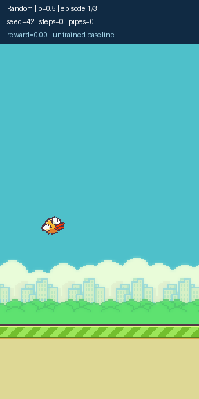

# Game Recordings

Recordings are organized by algorithm. Each video is accompanied by an episode CSV, runtime metadata JSON, and PNG preview.

| Algorithm | Directory | Contents |
| --- | --- | --- |
| Random | [random/](random/) | Uniform random policy and probability comparison |
| DQN | [dqn/](dqn/) | DQN policy recordings |
| PPO | [ppo/](ppo/) | PPO policy recordings |

## Random Policy

| Recording | Policy | Episodes | Duration |
| --- | --- | ---: | ---: |
| [Uniform random policy](random/random_demo.mp4) | Flap probability 0.5 | 3 | 5.1 s |
| [Probability comparison](random/random_comparison.mp4) | Flap probabilities 0.5, 0.2, 0.1, 0.05 | 12 | 19.13 s |

[](random/random_comparison.mp4)

## Reproduce

Run from the repository root:

```bash
flappy-rl demo
flappy-rl demo --flap-probs 0.5 0.2 0.1 0.05 --output videos/random/random_comparison.mp4
```

Recordings use environment seeds 42–44 and include all consecutive episodes. See each video's JSON and CSV for its complete configuration and measured episode metrics.
